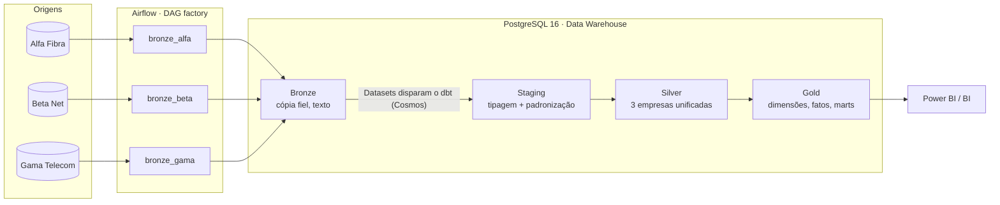

# Medallion com Airflow e dbt

[](https://github.com/jonatasvelloso/medallion-airflow-dbt/actions/workflows/ci.yaml)


Plataforma de dados que unifica **três empresas recém-fundidas** em um Data Warehouse único, seguindo a Arquitetura Medallion (Bronze → Silver → Gold). A ingestão é feita no **Airflow**, e as transformações e os testes rodam no **dbt**, orquestrado pelo **Cosmos** com disparo por **Datasets**.

> Todos os dados são **fictícios**, gerados com Faker. O projeto reproduz os padrões de arquitetura que uso em produção, sem nenhum código, regra ou dado de empregadores.

---

## O problema

Após uma fusão, três provedores de internet continuam operando seus próprios sistemas, cada um com convenções diferentes:

| | Alfa Fibra | Beta Net | Gama Telecom (legado) |
|---|---|---|---|
| Idioma das colunas | português | inglês | prefixos `tb_`, `cod_`, `dt_` |
| Valor do plano | `numeric` | centavos (`integer`) | texto com vírgula (`"119,90"`) |
| Status do contrato | `'ATIVO'`, `'CANCELADO'` | `1`, `2`, `3` | flags `'S'`/`'N'` |
| Datas | `date` | `date` / `timestamptz` | texto `DD/MM/AAAA` |
| Documento | `123.456.789-00` | só dígitos | `123.456.789-00` |

Além disso, cerca de 10% dos clientes da Beta também são clientes da Alfa. A diretoria precisa de **um único número** de base ativa, churn e receita recorrente, e de uma visão do **cliente consolidado** entre as empresas.

## Arquitetura



| Camada | Ferramenta | O que acontece |
|---|---|---|
| **Bronze** | Airflow + Python | Cópia fiel da origem, colunas como texto, upsert idempotente, carga incremental por marca d'água |
| **Staging** | dbt (views) | Tipagem e tradução de cada sistema para um contrato único de colunas |
| **Silver** | dbt (tables / incremental) | `UNION` das três empresas, chave por origem e identificação da mesma pessoa entre empresas |
| **Gold** | dbt (tables) | Modelo dimensional (dimensões, fatos e mart mensal) pronto para BI |

## Destaques técnicos

**Ingestão (Bronze)**
- **DAG factory declarativa.** As origens e entidades ficam em [`config/sources.yaml`](config/sources.yaml). Ingerir uma tabela nova é adicionar 4 linhas de YAML, sem escrever Python. O YAML é validado (identificadores, chave primária, schedule), o que também bloqueia SQL injection por configuração.
- **Incremental sem estado escondido.** A marca d'água é lida da própria Bronze (`max(coluna de alteração)`), não de uma Variable do Airflow: reprocessar ou recriar o ambiente não perde a posição. A releitura usa `>=` em vez de `>`, e o upsert torna a repetição inofensiva.
- **Upsert que só grava o que mudou** (`ON CONFLICT ... WHERE (...) IS DISTINCT FROM (...)`). Uma reexecução idempotente grava 0 linhas, e `_ingested_at` só avança quando o dado realmente mudou, o que alimenta o incremental da Silver.
- **Evolução de schema automática.** Uma coluna nova na origem vira uma coluna nova na Bronze.
- **Data quality antes da escrita.** Volume mínimo em cargas completas, chave nula e chave duplicada no lote. Se algo falha, a transação inteira é desfeita e a Bronze continua com a última versão válida.
- **Extração e carga com `COPY`** nos dois sentidos, sem passar linha a linha pelo Python.
- **Auditoria** de cada lote em `meta.ingestion_log` (modo, marca d'água, linhas extraídas e gravadas).
- **Núcleo independente do Airflow** ([`src/medallion`](src/medallion)). O mesmo código roda na DAG, no CI e na linha de comando, e é testado contra um Postgres real.

**Transformação (dbt)**
- **Orquestração orientada a dados.** Cada task da Bronze publica um Airflow Dataset, e a DAG do dbt dispara quando todas as entidades que consome foram atualizadas, sem horário fixo.
- **Cosmos** transforma cada model e cada teste em uma task do Airflow (`TestBehavior.AFTER_EACH`): um model que falha nos testes bloqueia os dependentes antes de contaminar a Gold.
- **dbt em virtualenv isolado** dentro da imagem, sem conflito de dependências com o Airflow.
- **Contrato de staging + macro `unir_origens`.** Todas as staging de uma entidade expõem as mesmas colunas, e a Silver é um `UNION` gerado a partir de `var('origens')`. Uma empresa nova entra criando só a staging dela.
- **Silver incremental** (`merge` por `_ingested_at`) na maior tabela.
- **LGPD.** O CPF não chega à Gold: a pessoa é identificada por um hash do documento.
- **Regras de negócio versionadas.** O SLA por tipo de ordem de serviço fica em uma seed, e o limite de churn precoce em uma `var`.
- **70+ testes de dados**: `unique`, `not_null`, `accepted_values`, `relationships`, um teste genérico próprio de grão e testes singulares de regra de negócio (por exemplo, o fechamento da base mensal: início + ativações − cancelamentos = fim).
- **Frescor das origens** com `dbt source freshness` sobre `_ingested_at`.

**Engenharia**
- **CI no GitHub Actions** em três jobs: lint (Ruff); testes + pipeline ponta a ponta em Postgres 16 (carga inicial, carga incremental e frescor); integridade das DAGs com Airflow 2.10 e Cosmos.
- **Ambiente completo com `make up`.**

## Modelo da Gold

| Tabela | Grão | Uso |
|---|---|---|
| `dim_clientes` | pessoa | Cliente consolidado entre as empresas (`qtd_empresas`, `cliente_multiempresa`) |
| `dim_planos` | plano | Segmento e velocidade extraídos do nome do plano |
| `dim_calendario` | dia | Competência, fim de semana, início e fim do mês |
| `fct_contratos` | contrato | Permanência, churn precoce, valor mensal |
| `fct_ordens_servico` | ordem de serviço | Horas de atendimento e cumprimento de SLA |
| `mart_base_mensal` | mês × empresa | Base ativa, ativações, cancelamentos, taxa de churn e MRR |

Exemplo de saída de `gold.mart_base_mensal` (dados fictícios):

| competência | empresa | base início | ativações | cancelamentos | base fim | churn | MRR (R$) |
|---|---|---:|---:|---:|---:|---:|---:|
| 2026-10 | alfa | 2.795 | 107 | 124 | 2.778 | 4,44% | 492.232,20 |
| 2026-10 | beta | 1.867 | 82 | 74 | 1.875 | 3,96% | 325.552,50 |
| 2026-10 | gama | 1.398 | 63 | 51 | 1.410 | 3,65% | 251.539,00 |

## Como rodar

**Com Docker** (recomendado):

```bash
make up          # cria o .env, sobe Postgres + Airflow e gera os dados fictícios
```

Na primeira execução o `make up` cria o `.env` a partir do [`.env.example`](.env.example). Troque as senhas nele: o `.env` não é versionado, e nenhuma credencial fica no código.

Acesse http://localhost:8080 com o usuário e a senha definidos no `.env`. As DAGs `bronze_alfa`, `bronze_beta` e `bronze_gama` rodam por agendamento, e a `dbt_medallion` dispara sozinha quando a Bronze termina. Para ver a carga incremental em ação:

```bash
make novo-dia    # cancela contratos e fecha ordens de serviço nas origens
```

O DW fica acessível em `localhost:5432` (banco `dw`, com as credenciais do `.env`), com os schemas `bronze_*`, `staging`, `silver`, `gold` e `meta`.

**Sem Docker** (Python 3.12 + Postgres local):

```bash
pip install -r requirements-dev.txt
export PGPASSWORD=<sua senha> DW_PASSWORD=<sua senha>
psql -U postgres -f scripts/init_databases.sql
make local       # gera dados → Bronze → dbt build
make test
```

## Estrutura

```
├── config/sources.yaml        # declaração da Bronze (origens, entidades, chaves, incremental)
├── dags/
│   ├── bronze_dags.py         # DAG factory: uma DAG por origem, uma task por entidade
│   └── dbt_medallion.py       # Cosmos: Silver/Gold disparadas por Datasets
├── src/medallion/             # núcleo da ingestão, independente do Airflow
│   ├── bronze.py              # extração, staging, data quality, upsert, auditoria
│   ├── config.py              # leitura e validação do sources.yaml
│   └── quality.py             # regras de qualidade do lote
├── dbt/
│   ├── models/staging/        # uma pasta por empresa, mesmo contrato de colunas
│   ├── models/silver/         # unificação das três empresas
│   ├── models/gold/           # dimensões, fatos e mart mensal
│   ├── macros/                # normalização, union por origem, teste genérico
│   ├── seeds/                 # regras de negócio versionadas (SLA)
│   └── tests/                 # testes singulares de regra de negócio
├── scripts/
│   ├── generate_data.py       # dados fictícios das três origens (+ --increment)
│   └── run_bronze.py          # Bronze sem Airflow (CI / depuração)
├── tests/                     # pytest: config, qualidade, Bronze em Postgres real, DAGs
├── docker-compose.yaml
└── .github/workflows/ci.yaml
```

## Autor

**Jonatas Veloso**, Engenheiro de Dados · [LinkedIn](https://www.linkedin.com/in/jonatasveloso)

Licença MIT.
